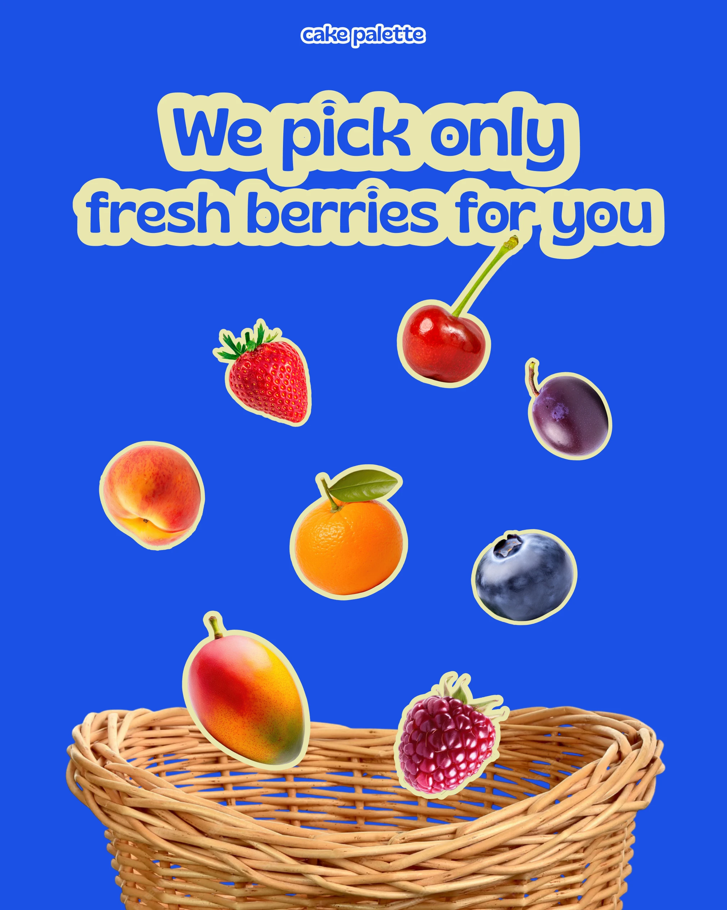

# Fruit stickers dropping into a wicker basket on cobalt

**Discipline:** print-social · **Design type:** Social promo post
**Tags:** food, stickers, cobalt, cream-outline, basket, bubble-type, cutout, motion

## What it is
A 4:5 post on flat cobalt with cream-outlined bubble headline 'We pick only fresh berries for you'. Eight cut-out fruits with thin cream borders fall towards a real wicker basket cropped at the bottom.

## What it means
Fresh, juicy and playful; bright fruit against strong blue looks like candy.

## Techniques
- Use complementary contrast (orange and red fruit on blue) for maximum pop.
- Outline stickers and headline with the same cream stroke to unify them.
- Imply motion by scattering objects at different angles above their destination.
- Crop a real object (basket) at the edge as a stage.

## Best for
- Food and produce promotions
- Seasonal social posts
- Any product with many small items

## Vocabulary
- **Sticker outline** — A thin border around a cutout.
- **Falling composition** — Objects scattered above a container to imply motion.
- **Outlined headline** — Text with a thick stroke around the letters.
- **Colour complement** — Opposite colours creating strong contrast.
