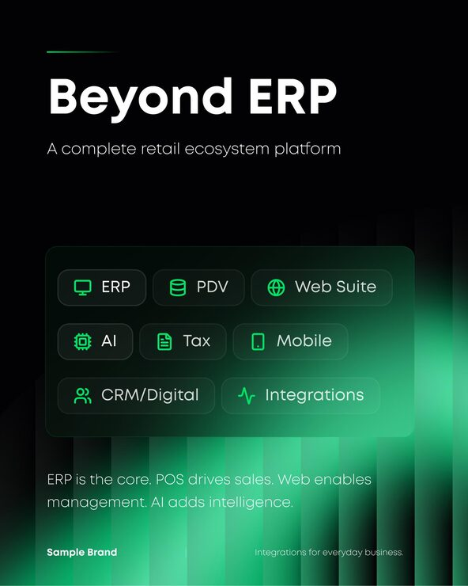

# 'Beyond ERP' post with a glass panel of green-icon module chips over glowing green light bars

**Discipline:** print-social · **Design type:** Product UI promo card · **Design style:** Dark & Neon
**Tags:** erp, retail, saas, dark, green, chips

## What it is
A portrait black post with a thin green rule, a huge white 'Beyond ERP' title and subtitle, a translucent panel holding pill chips with green line icons (ERP, PDV, Web Suite, AI, Tax, Mobile, CRM/Digital, Integrations), vertical green light bars glowing from the lower right, and a one-line summary.

## What it means
Comprehensive and sleek; chips make a complex suite feel like modular building blocks.

## Techniques
- Present product modules as icon chips.
- Group chips inside one glass panel.
- Glow vertical light bars from a corner.
- Sum up the ecosystem in one short line.

## Best for
- SaaS suites
- Retail tech
- B2B platform ads

## Vocabulary
- **Module chip** — A pill representing one product component.
- **Ecosystem** — A set of connected products.
