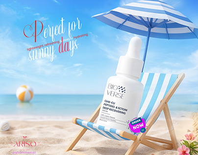

# Bioverse serum bottle on a striped beach chair under a parasol with a red script 'Perfect for sunny days'

**Discipline:** print-social · **Design type:** Social ad · **Design style:** Photographic & Cinematic
**Tags:** skincare, summer, beach, product-manipulation, script, ad

## What it is
A composite ad with a white serum dropper bottle sitting upright on a blue-and-white striped deckchair under a matching parasol on a sunny beach, a red script 'Perfect for sunny days' with small benefit words, a beach ball, pink flowers and an 'Order now' sticker.

## What it means
Playful and seasonal; putting the bottle in a human setting makes it feel like it's on holiday too.

## Techniques
- Place the product as if it were a person in a scene.
- Match the prop stripes to the product's colours.
- Weave small benefit words into a script headline.

## Best for
- Skincare summer campaigns
- Product manipulation ads
- Seasonal social posts

## Vocabulary
- **Product manipulation** — Compositing a product into a staged photo scene.
- **Personification** — Treating an object as if it were a person.
