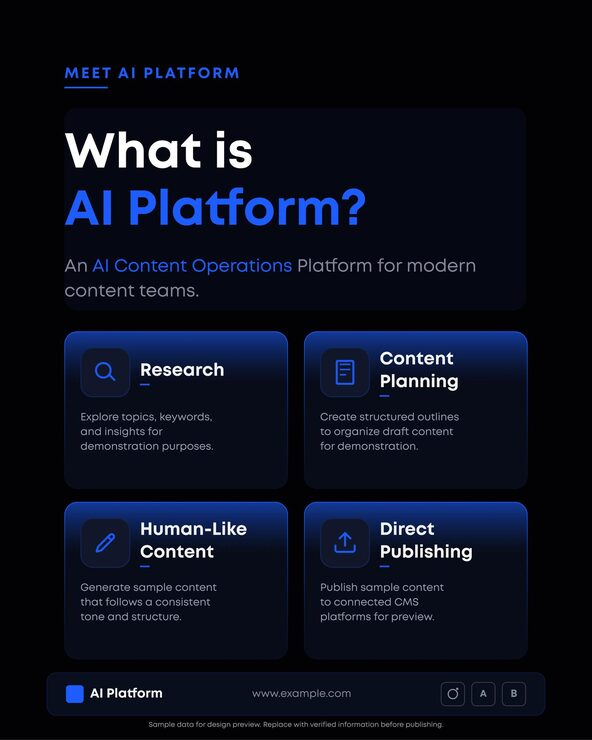

# Black 'What is AI Platform?' post with four blue-edged feature cards

**Discipline:** print-social · **Design type:** Product UI promo card · **Design style:** Dark & Neon
**Tags:** ai, saas, feature-grid, black, blue, cards, product-marketing

## What it is
A black portrait post: a small blue label 'Meet AI Platform', a large 'What is AI Platform?' headline with the product in blue, and a 2x2 grid of dark cards with blue top glows, line icons and titles (Research, Content Planning, Human-Like Content, Direct Publishing), plus a footer bar.

## What it means
Clean and product-led; the glowing cards feel like UI, making the post read as a preview of the software itself.

## Techniques
- Present features as a 2x2 card grid with icon tiles.
- Light each card with a subtle top gradient edge.
- Colour just the product name in the headline.
- Close with a footer bar that looks like app chrome.

## Best for
- SaaS feature announcements
- AI tool marketing
- Product explainer posts

## Vocabulary
- **Feature grid** — Equal cards each explaining one capability.
- **Edge glow** — A soft gradient light along a card border.
