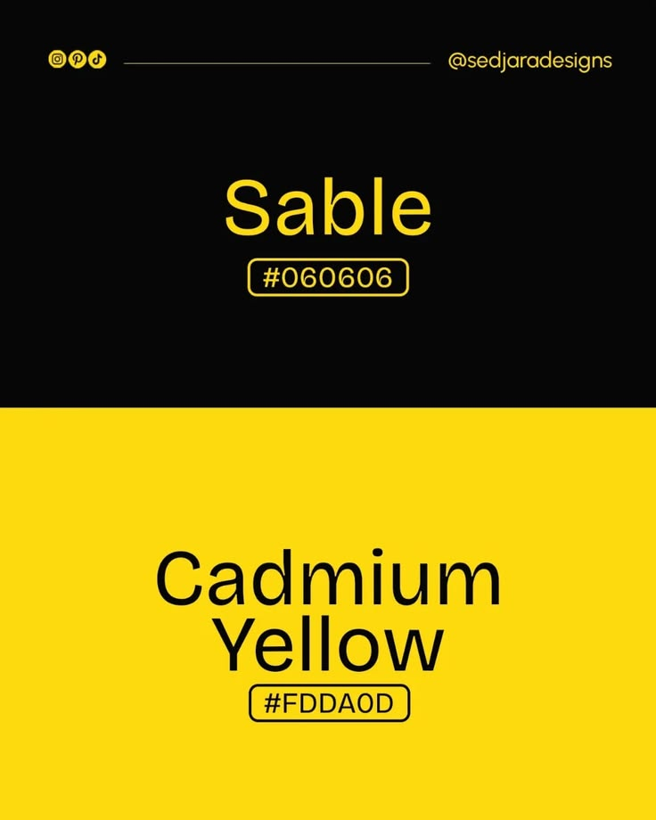

# Sable and Cadmium Yellow Colour Post

**Discipline:** print-social ·  · **Design style:** Minimalist
**Tags:** colour, black, yellow, split, hex, minimal, palette

## What it is
A portrait post split horizontally: a black upper half with yellow 'Sable #060606' and a yellow lower half with black 'Cadmium Yellow #FDDA0D', each hex code in an outlined pill, with a social handle bar at the top.

## What it means
Each colour becomes its own background and its partner becomes the text, so the pairing is demonstrated as it is named.

## Techniques
- Swap colours between halves to show contrast pairs
- Hex code in an outlined pill
- Large centred colour name in simple sans
- Thin line and icons in the header as a subtle brand
- Only two colours in the entire design

## Best for
- Colour palette and naming posts
- Minimal two-colour brand layouts
- Design inspiration accounts

## Vocabulary
- **Colour pairing** — Two colours chosen to work together.
- **Inverted halves** — Two areas where foreground and background swap.
- **Hex code** — A six-digit code specifying a screen colour.
