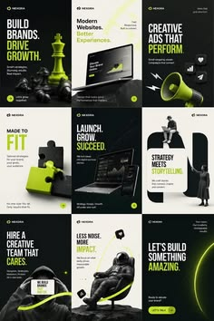

# Nine black, cream and lime agency posts with chess piece, megaphone, astronaut and puzzle 3D objects

**Discipline:** print-social · **Design type:** Social template pack
**Tags:** agency, black, lime, cream, 3d-objects, templates, bold-type, grid

## What it is
A 3x3 grid of posts alternating black, cream and lime with bold headlines such as 'Build brands. Drive growth.', glossy black 3D objects (chess pieces, laptop, megaphone, puzzle, astronaut chair), photo cutouts and small pill buttons.

## What it means
Sharp and energetic; glossy black objects with lime highlights feel like a bold agency.

## Techniques
- Give each message a glossy black 3D object.
- Alternate black, cream and lime backgrounds.
- Use lime for highlights and buttons.
- Keep headlines heavy and short.

## Best for
- Agency and studio posts
- 3D metaphor carousels
- Black and lime brands

## Vocabulary
- **Glossy black 3D** — A shiny black rendered object.
- **Background rotation** — Cycling three background colours across posts.
- **Lime highlight** — A bright green accent on a dark or cream base.
- **3D metaphor** — An object standing for an idea.
