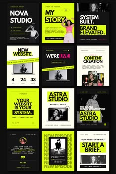

# Small mosaic of black, lime and cream studio posts with heavy condensed type and portrait cutouts

**Discipline:** print-social · **Design type:** Social template pack
**Tags:** agency, black, lime, cream, condensed-type, portrait, templates, mosaic

## What it is
A pin preview of nine to twelve portrait posts for a studio: black cards with lime headlines ('SYSTEM BUILT. BRAND ELEVATED.'), lime cards with black type ('YOUR WEBSITE IS YOUR SYSTEM.'), cream cards, laptop mockups, a countdown, episode covers and a brief call to action.

## What it means
Bold and startup-like; lime and black feel like a signal.

## Techniques
- Alternate black, lime and cream cards.
- Use condensed uppercase headlines.
- Mix laptop mockups with portrait cutouts.
- Add countdown and episode cover formats.

## Best for
- Design studio social systems
- Web design agency posts
- Lime and black brands

## Vocabulary
- **Post mosaic** — A grid overview of many posts.
- **Countdown card** — A post with time units.
- **Episode cover** — A cover for a series episode.
- **Brief CTA** — A call to start a project brief.
