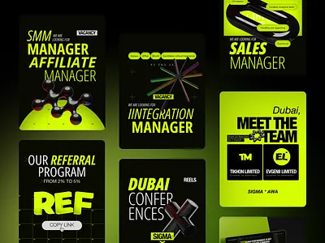

# Black and neon lime job-vacancy and referral posts with 3D molecules

**Discipline:** print-social · **Design type:** Social template pack
**Tags:** recruitment, black, neon-lime, 3d-objects, condensed-type, templates, vacancy

## What it is
A cluster of vertical black cards with heavy condensed lime headlines like 'MANAGER', 'REF' and 'MEET THE TEAM', accompanied by glossy black 3D molecule or star objects and small label chips.

## What it means
Edgy, high-energy and startup-like; neon lime on black feels like a signal.

## Techniques
- Set job titles in giant condensed caps in one neon colour.
- Add glossy black 3D objects to give depth to text posts.
- Use small chips (VACANCY, REELS) as category tags.
- Alternate solid lime cards with black ones.

## Best for
- Recruitment and employer-branding posts
- Tech and crypto communities
- Announcement templates

## Vocabulary
- **Neon-on-black** — A very bright colour on a dark background.
- **Condensed caps** — Tall narrow uppercase letters.
- **3D molecule** — A glossy render of connected spheres.
- **Category chip** — A small label describing a post type.
