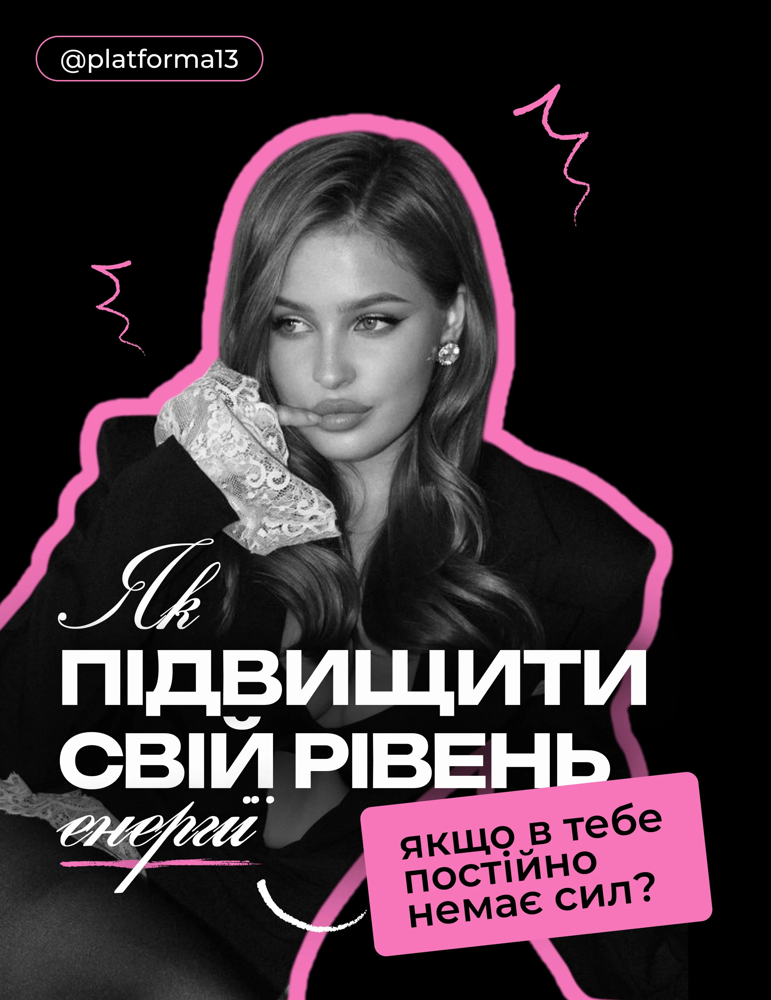

# Greyscale portrait with thick pink outline on black, white script and heavy caps, pink label and crayon squiggles

**Discipline:** print-social ·  · **Design style:** Photographic & Cinematic
**Tags:** cover, black, pink, greyscale, white-outline, script, heavy-caps, cyrillic

## What it is
A black portrait post with a pink pill handle, a greyscale woman resting her chin on a lace cuff cut out with a thick pink outline, crayon pink squiggles, a white script 'Як', heavy white extended 'ПІДВИЩИТИ СВІЙ РІВЕНЬ', a script 'енергії' with a brush underline and a tilted pink label with black rounded text.

## What it means
Glamorous and bold; pink outline and script make a mono portrait feel like a magazine cover.

## Techniques
- Outline the cutout in pink.
- Stack script over heavy caps.
- Add a tilted label for the question.
- Use crayon squiggles.

## Best for
- Personal growth and lifestyle covers
- Black and pink systems
- Cutout covers

## Vocabulary
- **Accent outline** — A thick colour border around a cutout.
- **Script overlay** — A flourished word over bold type.
- **Brush underline** — A painted stroke under text.
- **Tilted label** — A rotated colour box with text.
