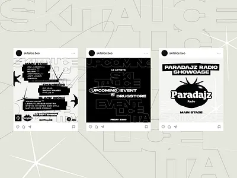

# Three black-and-white club posts with giant ghost outline type, lineup lists, sparkles and a tomato radio stamp

**Discipline:** print-social ·  · **Design style:** Dark & Neon
**Tags:** music, club, black-and-white, outline-type, lineup, sparkle, stamp, instagram

## What it is
Three Instagram posts on pale grey with faint giant outline lettering behind: a white lineup post with stepped black label blocks and sparkle stars, a black 'UPCOMING EVENT IN DRUGSTORE' post with outlined and solid words, and a white 'PARADAJZ RADIO SHOWCASE' post with a black tomato-shaped stamp logo and 'MAIN STAGE'.

## What it means
Underground and graphic; stark black and white with ghost lettering feels like a zine flyer.

## Techniques
- Set giant outlined lettering as texture.
- Stack lineup names in black label strips.
- Use sparkle glyphs and a stamp logo.
- Keep to black and white.

## Best for
- Club and radio event posts
- Black-and-white social sets
- Typographic flyers

## Vocabulary
- **Ghost outline type** — Giant outlined letters at low contrast.
- **Lineup strips** — Artist names on black label bars.
- **Stamp logo** — A logo shaped like a rubber stamp.
- **Monochrome set** — A set of posts in black and white only.
