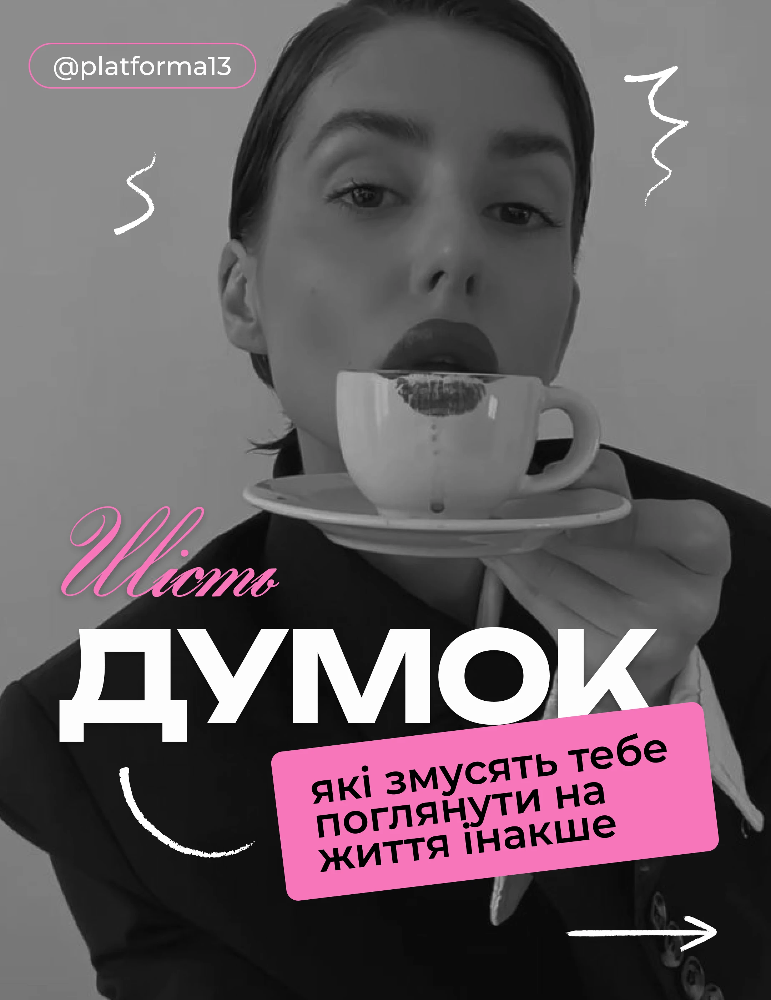

# Greyscale portrait cover with pink script, giant caps and a tilted pink label

**Discipline:** print-social ·  · **Design style:** Playful & Illustrated
**Tags:** cover, greyscale, pink, script, heavy-caps, tilted-label, doodles, cyrillic

## What it is
A black-and-white photo of a woman sipping from a cup with lipstick print, overlaid with a hot-pink script number, a giant white extended caps word, a tilted pink rounded rectangle with black caption text, white scribbles and a handle pill.

## What it means
Edgy, feminine and confident; pink punches through the monochrome photo.

## Techniques
- Convert the photo to greyscale so a single pink can dominate.
- Pair a flourished pink script with a very heavy extended sans word.
- Tilt a pink caption block to break the grid.
- Add white chalk doodles as accents.

## Best for
- Personal brand and community accounts
- Carousel opening covers
- Women-focused content

## Vocabulary
- **Greyscale base** — A black-and-white photo that lets colour accents stand out.
- **Script accent** — A flowing script word for emphasis.
- **Tilted caption block** — A rotated colour rectangle holding text.
- **Chalk doodle** — A rough white hand-drawn line.
