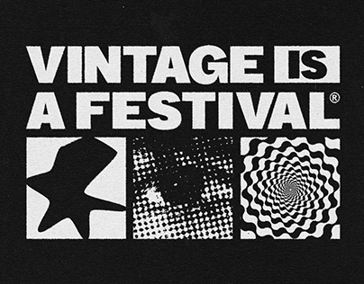

# Black and white 'VINTAGE IS A FESTIVAL' poster with a star, a halftone eye and an op-art spiral in three boxes

**Discipline:** print-social ·  · **Design style:** Retro & Pixel
**Tags:** festival, black-and-white, halftone, op-art, heavy-type, boxes, grunge, vintage

## What it is
A black textured field with a huge heavy white title 'VINTAGE IS A FESTIVAL®' where IS is reversed in a white box, and below three white-outlined boxes: a stylised star, a halftone dot close-up of an eye and a swirling op-art spiral.

## What it means
Loud and retro; three graphic techniques in boxes show the festival's mix of eras.

## Techniques
- Reverse one word in a white box.
- Show three image treatments in three boxes.
- Use heavy grotesque type.
- Add grain to the black.

## Best for
- Festival and vintage event posters
- Black-and-white graphics
- Halftone and op-art mixes

## Vocabulary
- **Reversed word** — A word in a box with inverted colours.
- **Halftone eye** — An eye rendered in dots.
- **Op-art spiral** — A vibrating black-and-white spiral.
- **Triptych boxes** — Three framed image boxes in a row.
