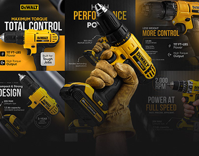

# Six black and yellow power-drill ads with big condensed headlines, macro photos and spec callouts

**Discipline:** print-social ·  · **Design style:** Dark & Neon
**Tags:** product, tools, black, yellow, condensed-type, macro, spec-callouts, ads

## What it is
A grid of dark ads for a yellow drill: headlines like 'MAXIMUM TORQUE TOTAL CONTROL', 'HIGH PERFORMANCE POWER', '2,000 RPM POWER AT FULL SPEED', close-ups of gloved hands and the drill, spec callouts with thin lines and a yellow angled panel.

## What it means
Rugged and confident; the yellow product pops from black photography.

## Techniques
- Use black photography with yellow highlights.
- Set giant condensed headlines.
- Add thin callout lines to features.
- Include a yellow angled panel for a spec.

## Best for
- Tool and hardware ads
- Product spec posts
- Black and yellow brands

## Vocabulary
- **Spec callout** — A label with a thin line to a feature.
- **Angled panel** — A slanted colour block behind text.
- **Product macro** — A close-up of product detail.
- **Condensed headline** — A tall narrow bold headline.
