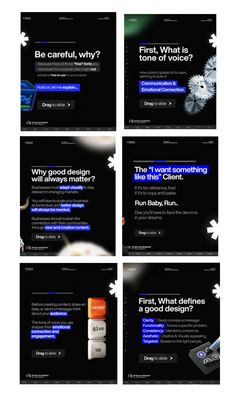

# Six black educational slides with blue highlight bars, big asterisks and a drag-to-slide pill

**Discipline:** print-social ·  · **Design style:** Dark & Neon
**Tags:** carousel, black, blue, asterisk, highlights, education, design, swipe

## What it is
A pin preview of six portrait slides on black with a small logo strip, white bold questions ('Be careful, why?', 'First, What is tone of voice?') with blue highlighted phrases, white asterisk stickers, 3D objects like gears and a bag and a 'Drag to slide' pill at the bottom.

## What it means
Bold and instructional; blue highlights and asterisks give structure on black.

## Techniques
- Highlight key phrases with blue bars.
- Add big white asterisks.
- Use 3D object accents.
- End each slide with a swipe pill.

## Best for
- Design education carousels
- Dark question-led slides
- Blue highlight systems

## Vocabulary
- **Highlight bar** — A coloured bar behind text.
- **Asterisk sticker** — A large white asterisk graphic.
- **Swipe pill** — A capsule prompting a swipe.
- **Question hook** — A slide opening with a question.
