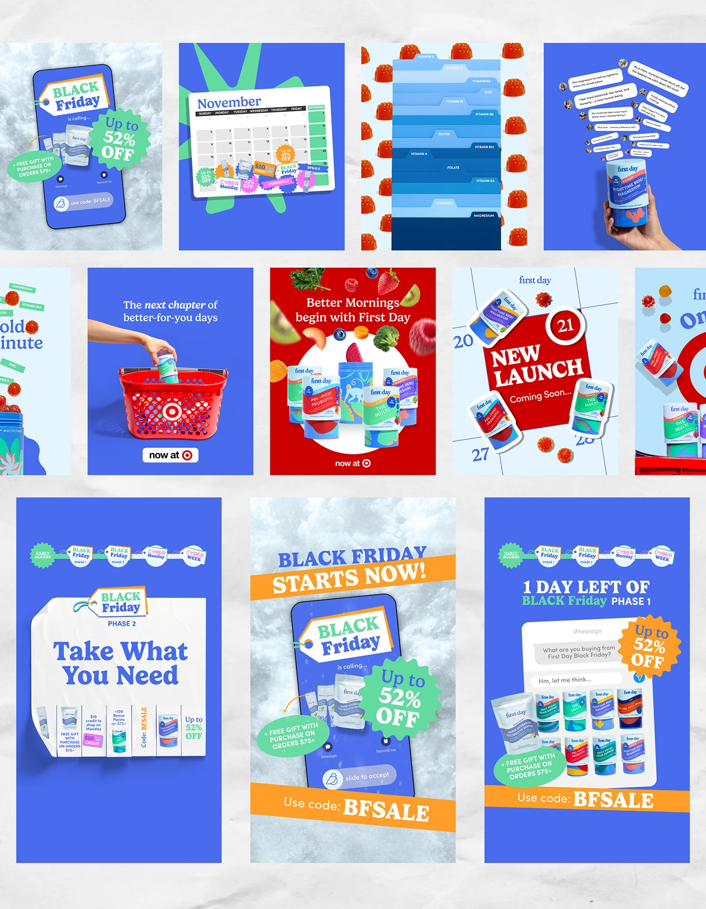

# Black Friday campaign set in cobalt with tags, starbursts and interface parodies

**Discipline:** print-social · **Design type:** Campaign social ad set
**Tags:** campaign, black-friday, cobalt, sale, starburst, phone-parody, calendar, retail, stories

## What it is
A collage of vertical ads for a supplement brand. Elements include a phone with a tag 'Black Friday is calling...' on frosty background, a November calendar covered in sale stickers, folder-tab vitamin lists, iMessage-style chat bubbles, red Target baskets, a 'NEW LAUNCH' calendar square, and orange banner 'BLACK FRIDAY STARTS NOW!' with 'Use code: BFSALE'.

## What it means
Busy but joyful; familiar interface parodies make a promo feel like fun content rather than an ad.

## Techniques
- Parody everyday interfaces (calendar, phone call, iMessage) to frame sale messages.
- Keep one cobalt base and add green, orange and red badge colours.
- Pile stickers, tags and starbursts on top of mock UI.
- Use a repeatable strip of campaign phases as a header.
- Break the pattern with a real product photo with retail props.

## Best for
- Seasonal sales and retail campaigns
- DTC brands with playful voices
- Multi-format story ad sets

## Vocabulary
- **UI parody** — Mimicking a familiar interface to deliver a message.
- **Campaign phase strip** — A header showing stages of a campaign.
- **Sale sticker** — A badge-shaped graphic announcing a discount.
- **Story format** — A tall 9:16 layout used for stories.
