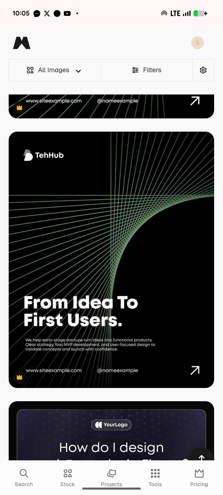

# Green Line Lattice From Idea to First Users

**Discipline:** print-social · **Design type:** Social ad
**Tags:** black, green, line-art, lattice, startup, tall-post, minimal

## What it is
A black tall post with a white logo top left, thousands of thin green lines fanning from two edges into a curved lattice, a bold white headline 'From Idea To First Users.', a small paragraph and a footer of website, handle and an arrow.

## What it means
String-art lines curving across the top give a technical elegance with a single colour and no imagery.

## Techniques
- String-art lattice made of fine lines
- One green on pure black
- Heavy headline low left
- Small paragraph and footer as a quiet base
- Diagonal arrow icon as the exit cue

## Best for
- Startup and dev-agency posts
- Line-art backgrounds
- Minimal dark templates

## Vocabulary
- **String art** — Straight lines arranged to create curved shapes.
- **Line lattice** — A grid formed by crossing line bundles.
- **Footer row** — A base row holding the site, handle and arrow.
