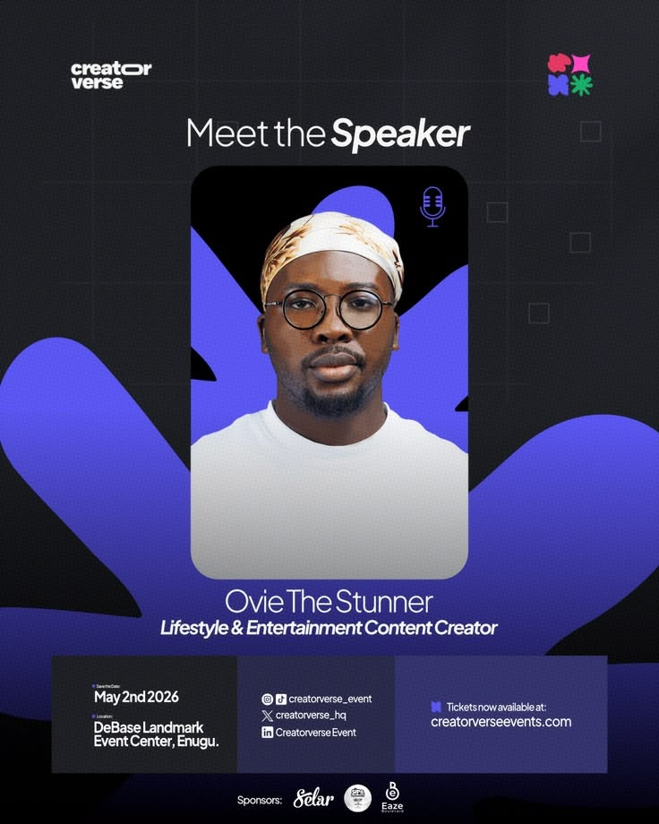

# Speaker Announcement on Indigo Blob

**Discipline:** print-social · **Design type:** Event speaker card
**Tags:** speaker, indigo, black, blob, portrait, event, details-bar

## What it is
A dark event poster with 'Meet the Speaker' in light and italic type, a rounded portrait card over a big indigo splat shape with a mic icon, the speaker's name and role, an info bar with date, socials and ticket link, and sponsor logos.

## What it means
The indigo blob gives the portrait a lively backdrop, and the tidy info bar keeps the details clear.

## Techniques
- Organic blob shape behind a rounded portrait
- Two-weight headline with italic emphasis
- Three-cell info bar for date, socials and tickets
- Faint grid and square outlines in the background
- Sponsor logos in a row at the base

## Best for
- Event speaker announcements
- Conference social series
- Dark posters with a splash of colour

## Vocabulary
- **Speaker card** — A portrait and details announcing one speaker.
- **Info bar** — A strip with practical details divided into cells.
- **Splat shape** — A bold organic shape used as a backdrop.
