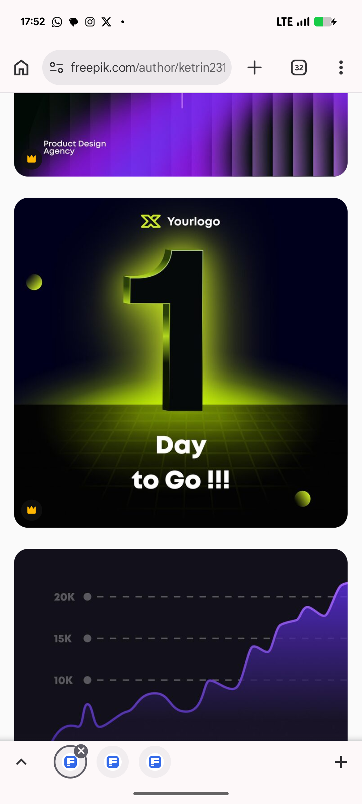

# Glowing 3D One Day to Go Countdown

**Discipline:** print-social · **Design type:** Social ad
**Tags:** countdown, 3d, lime, black, glow, grid-floor, launch, vector

## What it is
A stock-vector square post on near-black with a logo at the top, a giant black extruded numeral 1 standing on a lime-lit perspective grid floor with a bright horizon glow, the words 'Day to Go !!!' in white, and two small lime spheres; below it a purple area chart on a dark card.

## What it means
A numeral lit like a monolith makes the countdown feel like an arrival, and the lime horizon is the only colour.

## Techniques
- Giant extruded numeral as the hero
- Perspective grid floor with a glowing horizon
- Black object against a bright glow for a rim effect
- Two small spheres as accents
- Short white caption under the number

## Best for
- Launch countdown posts
- Event teaser series
- 3D numeral graphics

## Vocabulary
- **Extruded numeral** — A number given 3D depth.
- **Grid floor** — A receding grid plane used as a ground.
- **Horizon glow** — A bright band of light along a scene's horizon.
