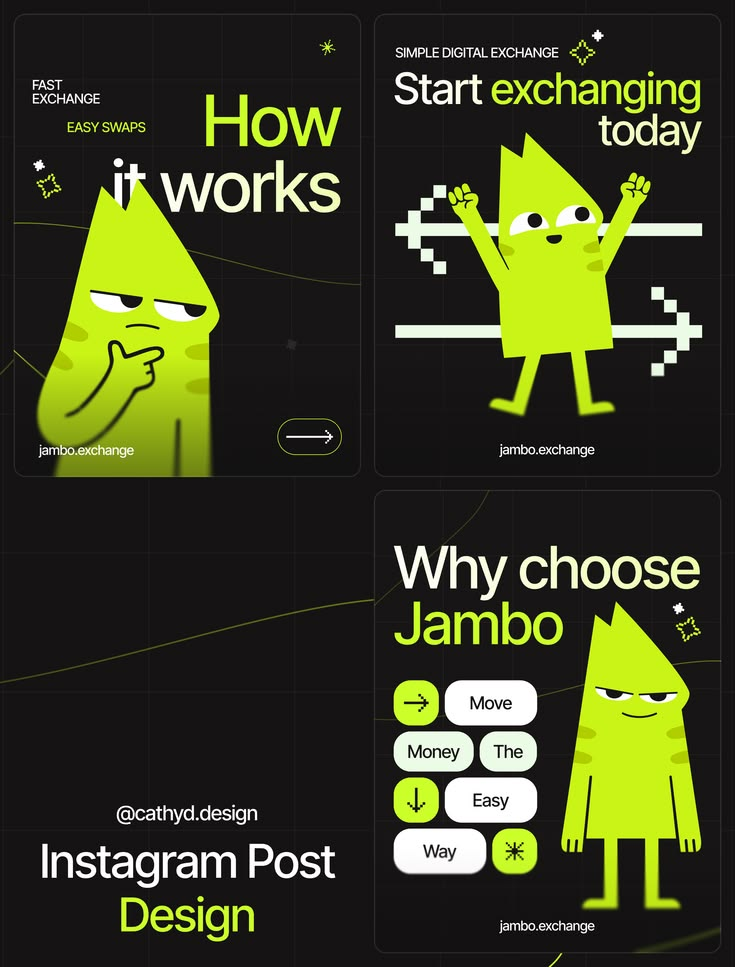

# Lime Mascot Exchange Post Set

**Discipline:** print-social · **Design type:** Social template pack
**Tags:** mascot, lime, black, exchange, instagram, pixel-arrows, grid

## What it is
A black board of three portrait posts featuring a lime character with a spiky head: 'How it works' with a thinking mascot, 'Start exchanging today' with the mascot between pixel arrows, and 'Why choose' with word-chip buttons, plus a designer credit.

## What it means
A charming mascot and one neon lime make a dry exchange product feel friendly, and pixel arrows add a digital note.

## Techniques
- One mascot in different poses per post
- Neon lime and cream type on black
- Pixel-art arrows for swap imagery
- Chips forming a sentence
- Faint grid and chart line background

## Best for
- Crypto and exchange social sets
- Mascot-led brands
- Explainer post series

## Vocabulary
- **Brand mascot** — A character that represents the brand across designs.
- **Pixel arrow** — An arrow made of square pixels.
- **Chip sentence** — Words placed in rounded chips that read as a phrase.
