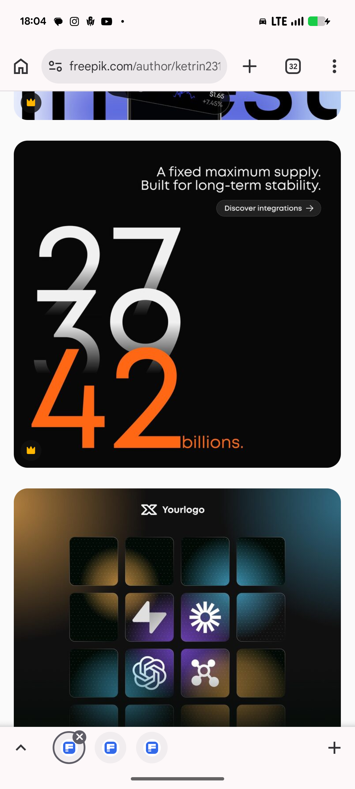

# Stacked Numerals Supply Stat and Integration Grid

**Discipline:** print-social · **Design type:** Social ad
**Tags:** stat, numerals, black, orange, gradient-type, integrations, tiles, vector

## What it is
A black square post with a right-aligned line 'A fixed maximum supply. Built for long-term stability.', a Discover integrations pill and a huge stack of numerals 27, 30 and 42 fading from white to grey into a solid orange 42 followed by 'billions.'; below it a teal-and-amber gradient post with a logo and a 4-by-3 grid of dark tiles holding partner icons.

## What it means
Fading digits climbing into an orange one turn a number into a rising graphic, and a tile grid presents partners tidily.

## Techniques
- Numerals fading from white to orange
- Small right-aligned caption above a huge figure
- Outlined pill as the call to action
- Dark tiles with a few coloured logo tiles
- Amber and teal blurred gradient background

## Best for
- Big-number stat posts
- Integration and partner showcases
- Crypto and tech marketing

## Vocabulary
- **Gradient numerals** — Digits whose fill fades from one tone to another.
- **Integration grid** — A grid of tiles showing partner logos.
- **Stat stack** — Several numbers stacked to form a shape.
