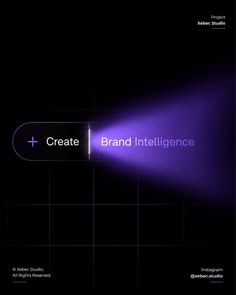

# Black poster with a glowing pill button emitting a violet light beam over a faint grid

**Discipline:** print-social · **Design type:** Social cover post
**Tags:** dark, violet, light-beam, pill, grid, minimal, studio, ai

## What it is
A black portrait with a faint line grid, a glass pill with a plus and 'Create' from which a violet light beam fans out to the right, the words 'Brand Intelligence' in the beam and tiny credits and handle in the corners.

## What it means
Futuristic and focused; a button emitting light suggests creation as a power.

## Techniques
- Turn a UI pill into a light source.
- Fan a coloured beam across the frame.
- Keep a faint grid.
- Use tiny corner text.

## Best for
- AI and creative studio posts
- Dark minimal posters
- UI-inspired art

## Vocabulary
- **Light beam** — A fan of coloured light.
- **UI pill** — An interface button as a graphic.
- **Faint grid** — A subtle line grid in the background.
- **Corner credits** — Small text in the corners.
