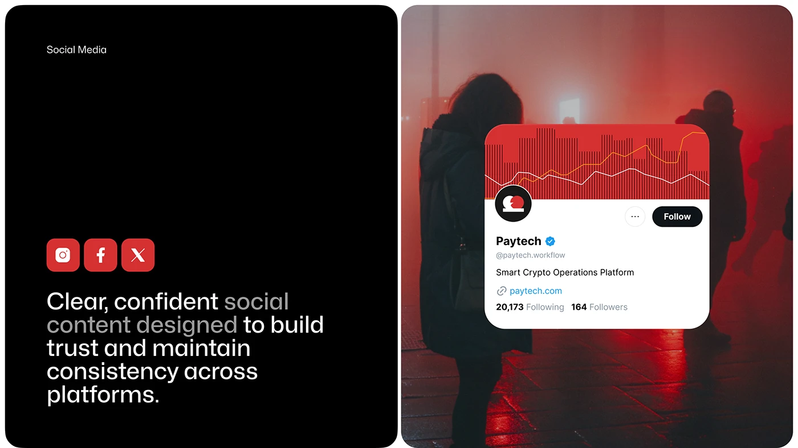

# Social Media Intro and Profile Card over Red Fog

**Discipline:** print-social ·  · **Design style:** Photographic & Cinematic
**Tags:** social-media, black, red, profile-card, fog, photography, icons

## What it is
A split board: a black panel with a 'Social Media' label, red platform icon tiles and a large statement about consistent social content, and a red-fogged night photo of figures overlaid with a white profile card whose cover is a red striped chart.

## What it means
The red fog photo carries the brand colour, and the profile card shows how the identity appears in a feed.

## Techniques
- Red-lit night photography
- Profile card overlaid on a photo
- Red rounded platform icons
- Statement with a dimmed phrase
- Two equal panels black and photo

## Best for
- Social media identity presentations
- Fintech brand boards
- Profile card mockups on photos

## Vocabulary
- **Profile card** — A card showing an account's avatar, name and stats.
- **Platform icons** — Logos of social networks used as tiles.
- **Brand-lit photo** — A photo lit in the brand colour.
