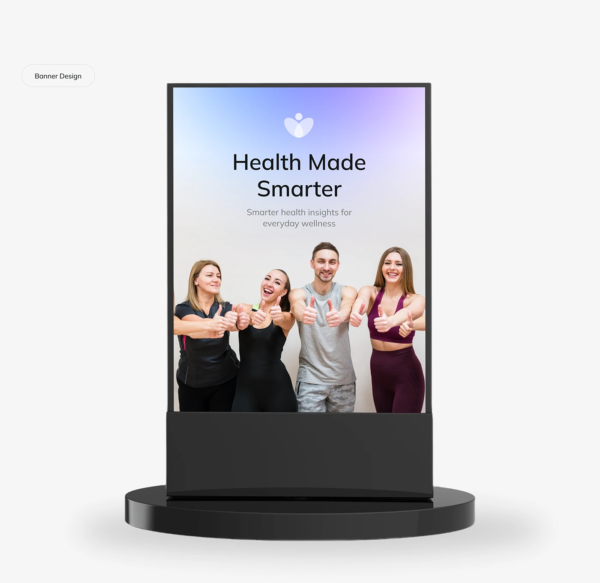

# Health Banner on a Black Display Stand

**Discipline:** print-social ·  · **Design style:** Gradient & Aurora
**Tags:** banner, stand, health, gradient, group-photo, thumbs-up, logo

## What it is
A pale page with a Banner Design pill and a black display stand on a round base holding a poster with a blue to lilac gradient header, a petal-person logo, a headline 'Health Made Smarter', a short line and a photo of four people giving thumbs up.

## What it means
A simple gradient header and a friendly group photo make a clear trust-building poster, and the stand shows it in use.

## Techniques
- Gradient header for the headline area
- Group photo bleeding to the bottom of the poster
- Centred logo above the headline
- Black stand with a round base
- Plain pale page around the mockup

## Best for
- Event and clinic banners
- Health brand posters
- Stand and display mockups

## Vocabulary
- **Display stand** — A floor stand that holds a poster upright.
- **Gradient header** — The upper area of a poster filled with a colour blend.
- **Group photo** — A photo of several people used to convey community.
