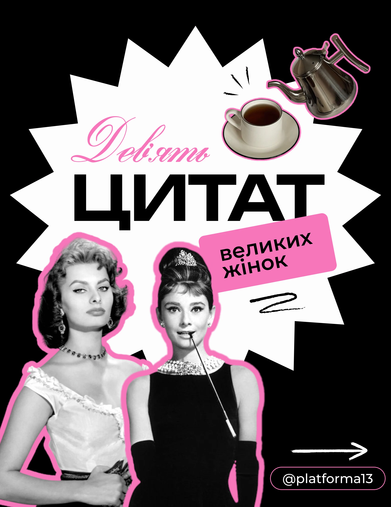

# Black post with white starburst, pink-outlined vintage portraits and tea props

**Discipline:** print-social · **Design type:** Social educational post
**Tags:** quotes, black, white-starburst, pink-outline, vintage-portraits, script, tea, cyrillic

## What it is
A black 4:5 post with a big white spiky starburst behind giant black caps 'ЦИТАТ', a pink script number, a tilted pink caption block, two black-and-white classic-film portraits with thick pink outlines, and pink-outlined stickers of a teacup and a kettle. Arrow and handle pill sit at the bottom.

## What it means
Glamorous and playful; vintage stars make quotes feel timeless while pink keeps it modern.

## Techniques
- Set a white starburst behind the title to create a burst of light.
- Give vintage black-and-white photos thick pink sticker outlines.
- Add small themed props (teacup, kettle) as stickers.
- Use one pink for script, label and outlines.

## Best for
- Quote and inspiration carousels
- Women-focused and lifestyle brands
- Retro-modern editorial posts

## Vocabulary
- **Starburst backdrop** — A spiky shape used as a highlight behind text.
- **Vintage cutout** — A classic black-and-white photo removed from its background.
- **Prop sticker** — A small object cutout that supports the theme.
- **Accent outline** — A single-colour stroke around all cutouts.
