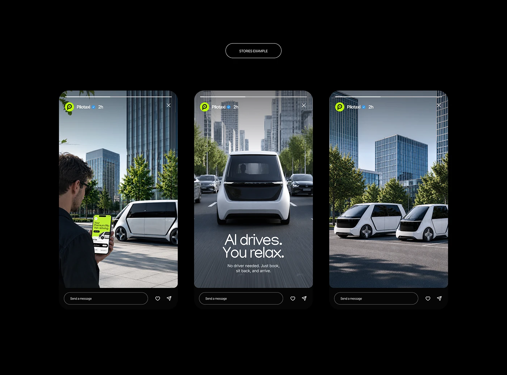

# Three Instagram stories on black: a man hailing the van, 'AI drives. You relax.' and parked vans in a city

**Discipline:** print-social · **Design type:** Story mockups
**Tags:** stories, mobility, black, photography, city, white-type, mockup, instagram

## What it is
A black board with an outlined 'STORIES EXAMPLE' pill and three story frames with a lime avatar 'Pilotaxi', progress bars and message bars: a man checking a lime app beside a white van, a van driving toward the camera with 'AI drives. You relax.' in thin white type and a sub line, and two vans parked among glass towers.

## What it means
Clean and futuristic; photography with one thin headline makes ads feel like content.

## Techniques
- Use full-bleed city photography.
- Put a single thin headline in one story.
- Keep story chrome authentic.
- Use a lime avatar as the only colour.

## Best for
- Mobility and tech story ads
- Instagram story mockups
- Photo-led minimal campaigns

## Vocabulary
- **Story chrome** — The progress bars, avatar and message bar around a story.
- **Thin headline** — Light-weight type for a calm message.
- **Story sequence** — Three frames telling a mini narrative.
- **Accent avatar** — A coloured profile icon in the story header.
