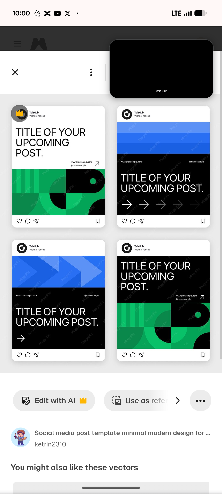

# Green Geometry and Blue Chevron Post Frames

**Discipline:** print-social ·  · **Design style:** Geometric & Bauhaus
**Tags:** instagram-frames, green, black, blue, chevrons, geometric, template, title-post

## What it is
Four Instagram post frames on light grey with the title 'TITLE OF YOUR UPCOMING POST.': a white post over a green and black geometric block pattern, a black post with blue bands and a row of fading arrows, a black post over blue chevrons and a black post above the green pattern, each with a top logo row and like, comment and share icons.

## What it means
Swapping the same title in different backgrounds shows a modular system, and fading arrows suggest movement to the next slide.

## Techniques
- Same headline over four different backgrounds
- Green quarter-circle and stripe block pattern
- Blue chevrons and bands as an alternate motif
- Row of arrows fading in opacity
- Real platform frames around each post

## Best for
- Social template previews
- Modular post systems
- Minimal black and colour templates

## Vocabulary
- **Frame preview** — A template shown inside platform post chrome.
- **Fading arrows** — A row of arrows reducing in opacity to imply motion.
- **Quarter-circle pattern** — Blocks each holding a quarter of a circle.
