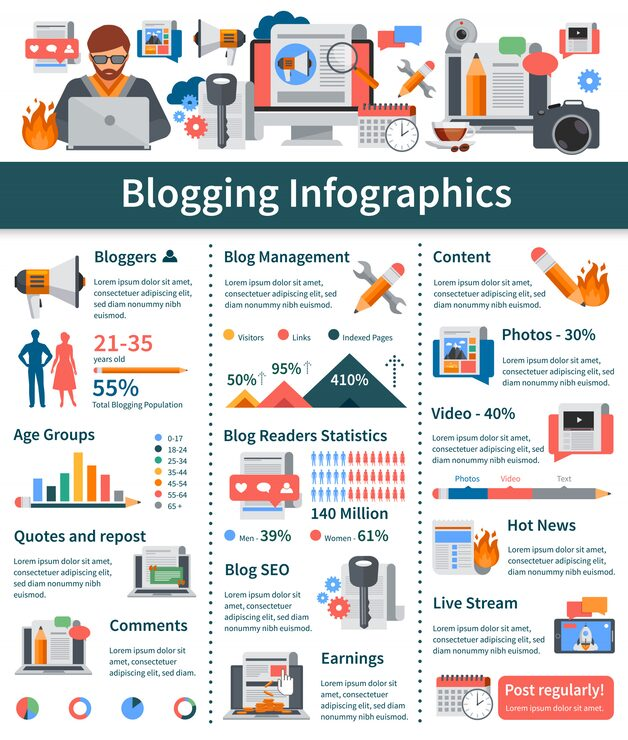

# 'Blogging Infographics' with a flat-icon header strip and a three-column layout of stats, charts and icons

**Discipline:** print-social · **Design type:** Product infographic set · **Design style:** Corporate & Clean-Tech
**Tags:** infographic, blogging, flat-icons, teal, three-column, stats

## What it is
A white infographic with a row of flat icons and illustrated props (blogger at a laptop, megaphone, monitor, camera, coffee cup) as a header strip above a bold teal 'Blogging Infographics' title bar, then three columns (Bloggers, Blog Management, Content) each mixing a stat (55% total blogging population, 21–35 years old), age-group bars, growth arrows (50%/95%/410%), reader statistics (140 million, 39% men/61% women) and content-type percentages (Photos 30%, Video 40%).

## What it means
Dense but navigable; the icon header and column structure let a stat-heavy infographic stay organised.

## Techniques
- Open an infographic with a row of topic icons and props as a visual index.
- Organise mixed content types (bars, percentages, icons) into consistent columns.
- Colour-code the header bar to anchor the whole piece.

## Best for
- Content marketing reports
- Blogging and media statistics
- Data-rich social infographics

## Vocabulary
- **Icon header strip** — A row of icons previewing an infographic's topics.
- **Three-column layout** — Content organised into three parallel vertical sections.
