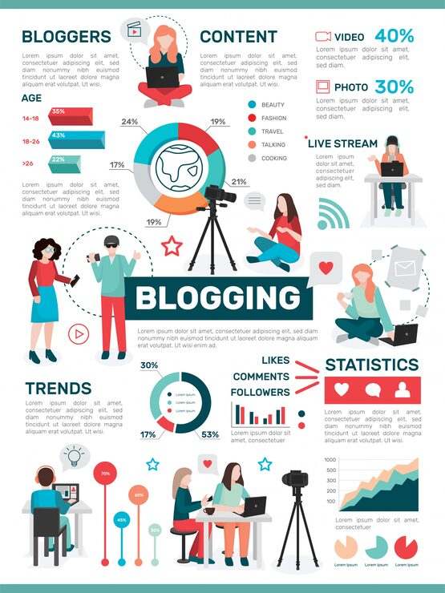

# 'Blogging' infographic with a central world-map ring chart, age-group bars and camera-crew illustrations

**Discipline:** print-social · **Design type:** Product infographic set · **Design style:** Corporate & Clean-Tech
**Tags:** infographic, blogging, teal, red, world-map, stats

## What it is
A teal-and-white infographic centred on a 'BLOGGING' banner, with a world-outline ring chart split by category (Beauty, Fashion, Travel, Talking, Cooking) at its centre, flanking illustrations of bloggers filming and vlogging, age-group percentage bars (14–18, 18–26, >26), a Trends donut chart, a Statistics panel with heart/comment/follower icons and bar charts, and a growth line chart at the bottom.

## What it means
Busy but anchored; centring everything around one ring chart keeps a stat-heavy poster from feeling scattered.

## Techniques
- Anchor an infographic around one central ring or donut chart.
- Illustrate the subject (bloggers) alongside their own statistics.
- Repeat a two-colour palette across every chart type for cohesion.

## Best for
- Social media marketing reports
- Content creator statistics
- Blogging industry infographics

## Vocabulary
- **Ring chart** — A circular chart, similar to a donut chart, split into proportional segments.
- **Growth line chart** — A chart showing a value's change over time.
