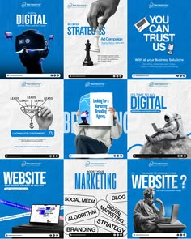

# Nine blue and white digital-marketing posts with 3D figures, chess, laptops and word clouds

**Discipline:** print-social ·  · **Design style:** 3D & Surreal
**Tags:** marketing, blue, white, 3d-figures, chess, laptop, templates, mosaic

## What it is
A 3x3 mosaic of square posts in royal blue and white with bold headlines such as 'DIGITAL', 'YOU CAN TRUST US', 'WEBSITE', 'MARKETING', mixing 3D-render characters, a chess piece, laptops, a funnel diagram and a word cloud of marketing terms.

## What it means
Energetic and clear; a blue system with 3D characters explains services.

## Techniques
- Alternate blue and white posts.
- Use 3D characters as illustrations.
- Set giant one-word headlines.
- Include a diagram and a word cloud.

## Best for
- Digital marketing agency posts
- Blue service systems
- Template mosaics

## Vocabulary
- **3D character** — A rendered figure used as a mascot.
- **Word cloud** — Words in different sizes forming a shape.
- **Funnel diagram** — A diagram of leads flowing to customers.
- **Post mosaic** — A grid overview of posts.
