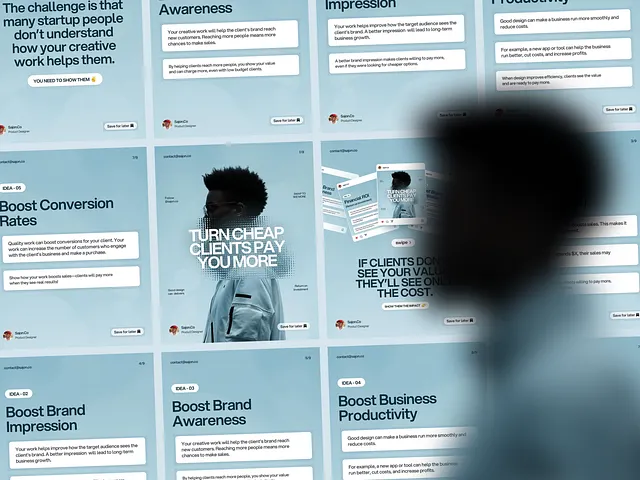

# Wall of misty-blue business carousel slides with white text cards and a blurred silhouette

**Discipline:** print-social · **Design type:** Social carousel
**Tags:** carousel, blue, mist, white-cards, typography, perspective, freelancers, grid

## What it is
A perspective grid of soft blue slides with headlines like 'Boost Conversion Rates', numbered idea labels, white rounded text cards and one photo slide with a man in a jacket and bold white caps, with a large blurred dark silhouette on the right.

## What it means
Airy and informative; white cards on foggy blue make reading easy.

## Techniques
- Use a mist-blue gradient background on every slide.
- Put the message in white rounded cards.
- Number ideas as small tags.
- Present slides in perspective with a blurred foreground.

## Best for
- Freelancer and design-education carousels
- Tip series
- Presentation of many slides at once

## Vocabulary
- **Mist gradient** — A foggy pale blue background.
- **Text card** — A white block holding body copy.
- **Idea tag** — A small label numbering a slide.
- **Foreground blur** — An out-of-focus object near the camera.
