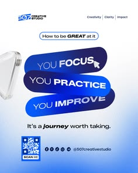

# Motivational post with three tilted blue pills, glass shape and QR code footer

**Discipline:** print-social · **Design type:** Social educational post
**Tags:** motivation, royal-blue, pills, glass-shape, qr-code, steps, gradient, creative-studio

## What it is
A white-to-blue gradient 4:5 post with a small outlined 'How to be GREAT at it' pill, three stacked tilted pills in blue tones reading 'You focus', 'You practice', 'You improve', a translucent glass shape at the left edge, a serif-italic sign-off line, a QR code and social icons.

## What it means
Clear and encouraging; stacked pills make a three-step message feel like a small ladder.

## Techniques
- Stack tilted capsule labels as a three-step list.
- Use darker blues down the stack to imply progress.
- Add a 3D glass object as a corner accent.
- Close with QR code and handles.

## Best for
- Motivational and tip posts
- Studio and agency social content
- Step-based messages

## Vocabulary
- **Stacked pills** — Rounded labels layered to form a list.
- **Tonal progression** — Colours deepening step by step.
- **Glass accent** — A translucent 3D shape used as decoration.
- **QR footer** — A scan code paired with handles at the bottom.
