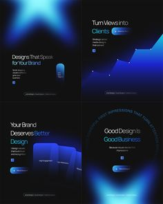

# Four dark posts with glowing blue starburst and thin sans

**Discipline:** print-social ·  · **Design style:** Gradient & Aurora
**Tags:** agency, dark, blue-glow, gradient-shapes, thin-type, 4-up, tech

## What it is
A 2x2 set of black squares with glowing blue shapes: a blurred star, rising chart with a glowing line, stacked translucent panels, and a ring of tiny text with a radiant glow. Small light sans headlines and pill buttons sit in each.

## What it means
Sleek and futuristic; glow and blur feel like a premium tech brand.

## Techniques
- Use blurred glowing shapes as the only imagery.
- Set small light headlines with pill CTAs.
- Vary the shape in each post while keeping the same colour.
- Use circular text as a graphic.

## Best for
- Design agencies and tech brands
- Minimal dark social sets
- Announcement posts

## Vocabulary
- **Glow shape** — A blurred luminous form used as artwork.
- **Circular text** — Text set along a ring.
- **Dark set** — A group of posts with a black base.
- **Translucent stack** — Overlapping semi-transparent panels.
