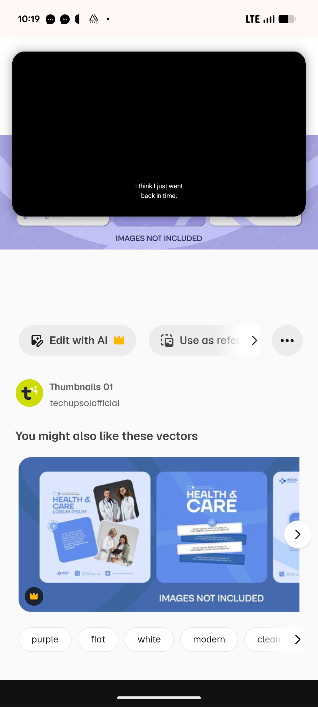

# Blue Health and Care Variant with Paper Strips

**Discipline:** print-social ·  · **Design style:** Warm & Organic
**Tags:** health, blue, paper-strips, group-photos, tilted-cards, template, medical, stock

## What it is
A stock preview strip showing a blue variant of the health-care set: a pale post with a headline and two tilted polaroid-style photos of doctors and a text card, a blue post with a big white 'HEALTH & CARE' over stacked paper strips of copy and a partly visible third post, over a lilac page captioned 'Images not included'.

## What it means
Torn paper strips and tilted photo cards give a friendly, handmade layer to a clinical topic.

## Techniques
- Stacked paper strips holding text
- Tilted photo cards like snapshots
- Heavy caps headline on a mid-blue field
- Pale and saturated versions of one layout
- Small logo and contact row at the base

## Best for
- Health-care and clinic templates
- Colourway variants of one design
- Paper-collage styles

## Vocabulary
- **Paper strip** — A narrow band of paper texture holding a line of text.
- **Snapshot card** — A tilted photo with a white border.
- **Colourway variant** — A copy of a layout in a different palette.
