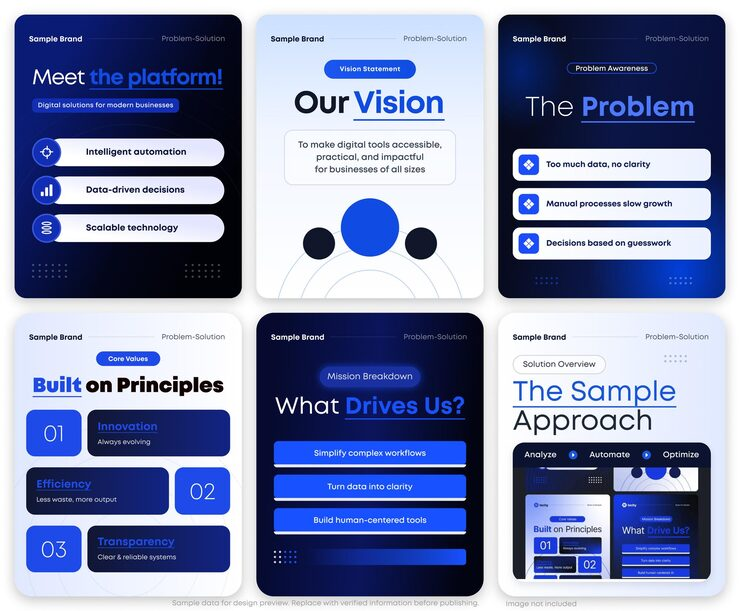

# Six-slide blue and white problem–solution carousel with icon pills and numbered value tiles

**Discipline:** print-social · **Design type:** Social carousel · **Design style:** Corporate & Clean-Tech
**Tags:** carousel, business, blue, problem-solution, values, saas, corporate

## What it is
Six portrait slides alternating navy and pale blue: 'Meet the platform!' with white icon pills, 'Our Vision' with circles, 'The Problem' with list cards, 'Built on Principles' with numbered 01/02/03 tiles, 'What Drives Us?' with blue bar buttons and 'The Sample Approach' showing mini slide previews.

## What it means
Organised and trustworthy; the consistent header and alternating tones make a pitch feel like a tidy deck.

## Techniques
- Alternate dark and light slides for rhythm.
- Underline and colour one word in each headline.
- Use big numbered tiles for values.
- Show thumbnails of your own slides as the proof slide.

## Best for
- Startup pitch carousels
- B2B platform explainers
- Company values posts

## Vocabulary
- **Deck-style carousel** — A carousel laid out like presentation slides.
- **Numbered tile** — A block showing a large index number.
