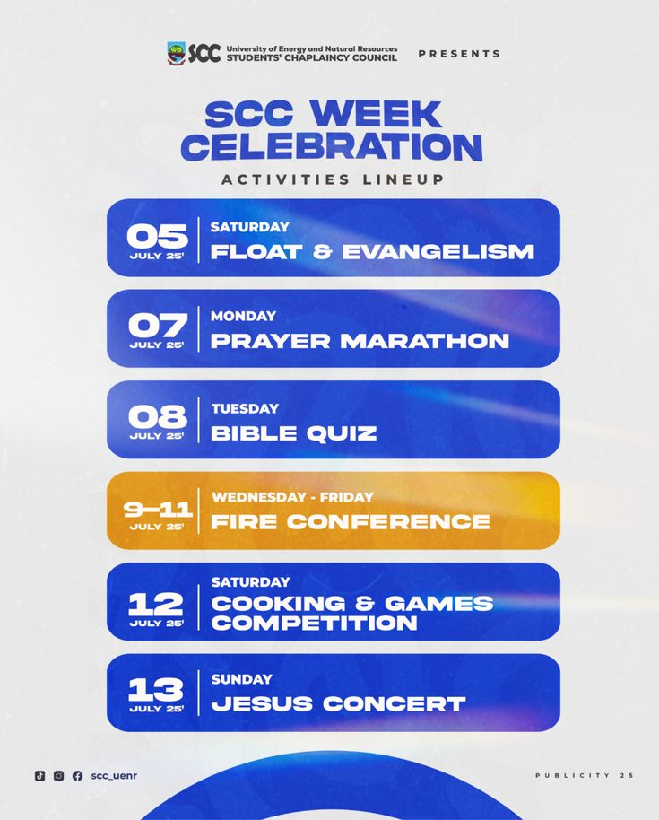

# Week Celebration Activities Lineup Flyer

**Discipline:** print-social · **Design type:** Event flyer
**Tags:** lineup, schedule, blue, rounded-bars, event, student, gold-highlight

## What it is
A pale portrait flyer with a logo presenter line, a heavy blue title 'SCC Week Celebration', 'Activities Lineup' and six rounded bars listing dates and events in white type, one bar in gold for the main conference, with social handles at the base and a blue arc at the bottom.

## What it means
Uniform bars make a schedule easy to scan, and the single gold bar marks the highlight.

## Techniques
- Date block with a vertical divider in each bar
- Uniform rounded blue bars stacked evenly
- One gold bar as the highlight
- Heavy italic-feel title in blue
- Light streak overlays on the blue for sheen

## Best for
- Event schedules and lineups
- Student and church events
- List-style flyers

## Vocabulary
- **Lineup bar** — A rounded strip showing a date and an event.
- **Highlight bar** — One bar in a different colour to mark the main event.
- **Date block** — A large number and month set apart by a rule.
