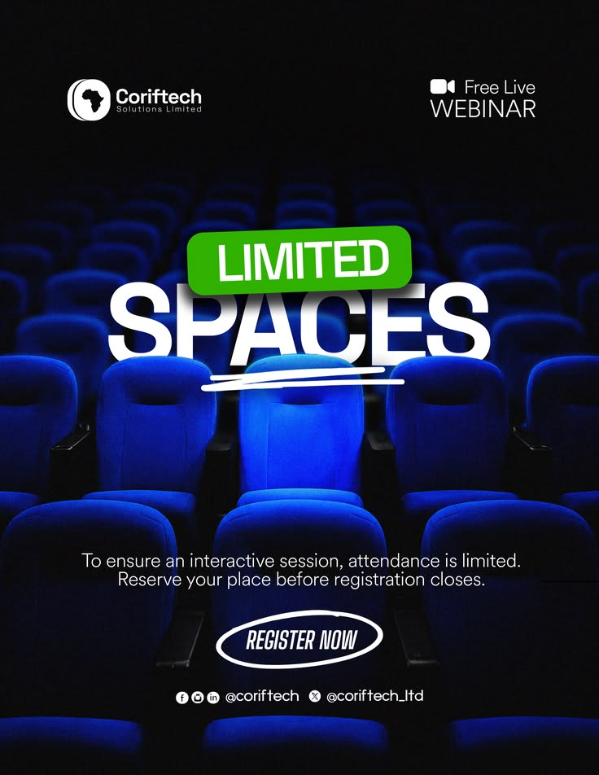

# Limited Spaces Webinar over Blue Theatre Seats

**Discipline:** print-social · **Design type:** Event flyer
**Tags:** webinar, blue, seats, dark, green-label, scarcity, flyer

## What it is
A dark flyer over a photo of glowing blue theatre seats with a green label 'LIMITED' above huge white 'SPACES' with a hand-drawn underline, logo and 'Free live webinar' at the top, a short paragraph and an outlined 'Register now' oval.

## What it means
Rows of seats literalise the scarcity message, and the one lit seat draws the eye.

## Techniques
- Photo that literally illustrates the message
- Green label sticker over heavy white type
- Hand-drawn underline scribble
- Outlined oval CTA
- Dark vignette to focus the centre

## Best for
- Webinar and event registration
- Scarcity messaging
- Photo-led social flyers

## Vocabulary
- **Scarcity message** — Copy stressing limited availability to prompt action.
- **Label sticker** — A coloured tag placed over a headline.
- **Outlined CTA** — A call to action drawn as an outline.
