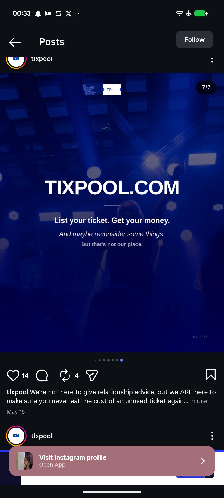

# Blue-Tinted Concert Photo Closing Slide

**Discipline:** print-social ·  · **Design style:** Photographic & Cinematic
**Tags:** carousel, closing, blue-tint, concert, photo, website, call-to-action

## What it is
A closing slide over a blue-tinted photograph of a concert crowd with stage lights, a ticket logo at the top, a large white 'TIXPOOL.COM' headline, a short rule and three lines: a bold offer 'List your ticket. Get your money.', an italic aside and a smaller quiet line.

## What it means
Tinting the crowd photo in the brand blue makes the closing feel atmospheric while keeping the site name front and centre.

## Techniques
- Blue tint over a concert photograph
- Website address as the headline
- Three text tiers under a short rule
- Ticket logo at the top
- Slide counter at the corner

## Best for
- Carousel closing slides
- Events and ticketing brands
- Photo backdrop CTAs

## Vocabulary
- **Colour tint overlay** — A translucent colour laid over a photo.
- **URL headline** — A website address used as the main call to action.
- **Closing slide** — The last slide of a carousel with the final ask.
