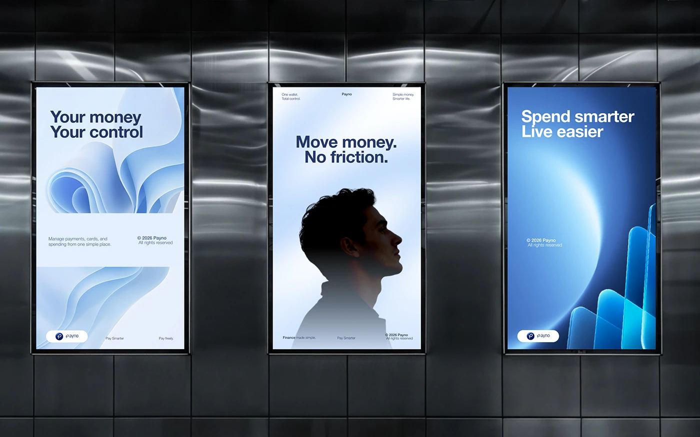

# Blue Wave Billboard Triptych in Metal Corridor

**Discipline:** print-social · **Design type:** Out-of-home poster set
**Tags:** billboards, blue, waves, silhouette, 3d-glass, corridor, fintech

## What it is
Three vertical screens on a brushed steel wall: pale blue paper-wave 3D art with 'Your money Your control', a blue silhouette profile with 'Move money. No friction.', and a deep blue orb with glass blocks and 'Spend smarter Live easier'.

## What it means
Three visual worlds in one blue palette show range while staying recognisably one brand.

## Techniques
- Three different image styles in one colour family
- Short two-line headlines in navy or white
- Pill logo lockup in each corner
- Metallic wall to contrast the soft blue
- Small legal and tagline text at the edges

## Best for
- Out-of-home campaigns
- Fintech brand awareness
- Poster series with a shared palette

## Vocabulary
- **Triptych** — A set of three related panels shown together.
- **Paper-wave render** — A 3D render of folded, flowing paper-like sheets.
- **Silhouette poster** — A poster built around a dark outline of a person.
