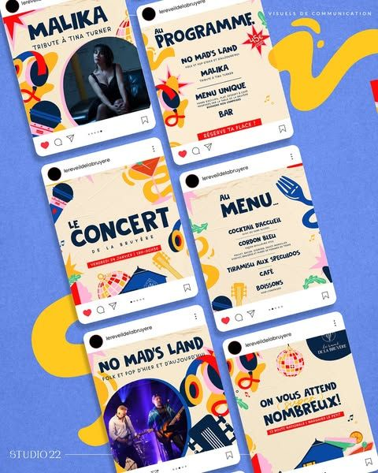

# Doodle Concert and Menu Instagram Set

**Discipline:** print-social · **Design type:** Instagram feed grid
**Tags:** instagram, concert, menu, doodles, blue, yellow, red, tilted

## What it is
A periwinkle board with six tilted Instagram post mockups for a venue: artist announcement, programme, concert title, menu, band photo and invitation, all in cream, navy, yellow and red with playful doodles of instruments, disco balls and food.

## What it means
Bold hand-drawn shapes and tilted posts give a festive, lively mood, and consistent doodles tie the set.

## Techniques
- Tilted post frames on a flat colour background
- Hand-drawn doodle icons (guitars, disco balls, forks)
- Navy display type with red highlights
- Cream cards with yellow blobs
- Photo circles cut inside the artwork

## Best for
- Restaurant and venue event promotion
- Instagram set presentations
- Playful hand-drawn systems

## Vocabulary
- **Doodle set** — A family of simple hand-drawn icons used as decoration.
- **Tilted mockup** — Posts rotated to add energy to a presentation.
- **Colour blob** — A loose coloured shape behind content.
