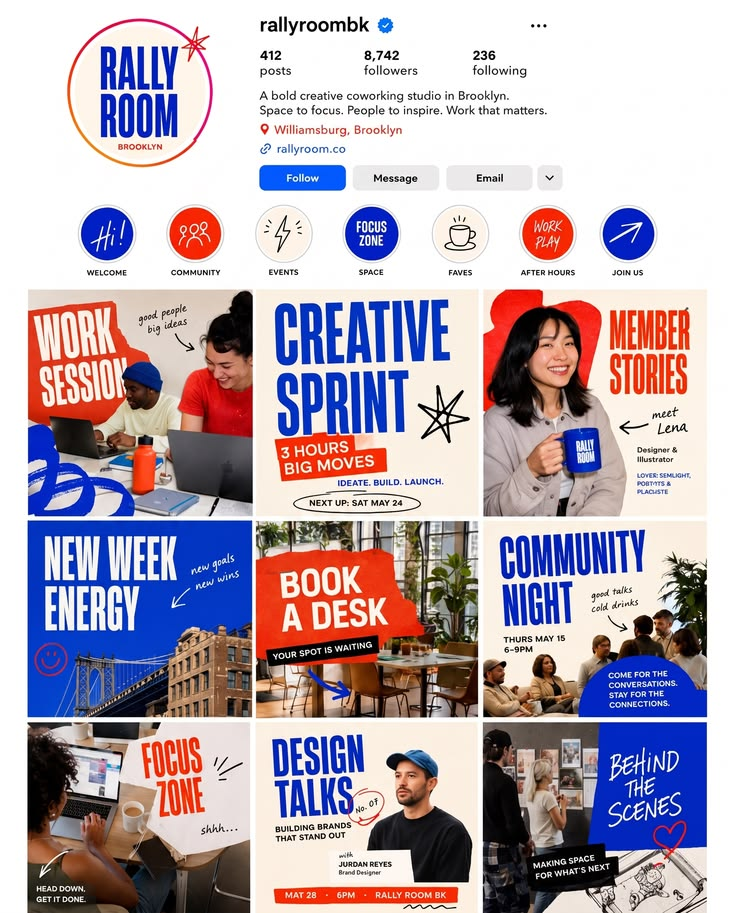

# Bold Blue, Red and Cream Coworking Feed

**Discipline:** print-social ·  · **Design style:** Playful & Illustrated
**Tags:** instagram, profile, grid, blue, red, cream, condensed, doodles

## What it is
A full Instagram profile for a Brooklyn coworking studio with a circular logo, highlight circles, and a 3-by-3 grid of posts in cobalt, red and cream with tall condensed type, torn shapes, hand-drawn doodles and candid photos.

## What it means
A strict three-colour palette and condensed type make a varied grid feel like one energetic brand.

## Techniques
- Cobalt, red and cream only across nine posts
- Tall condensed heavy type
- Torn-edge shapes behind photos
- Hand-drawn doodles and arrows as accents
- Highlight covers matching the palette

## Best for
- Community and coworking brands
- Instagram grid design
- Bold social identity

## Vocabulary
- **Feed grid** — The 3-by-3 block of posts seen on a profile.
- **Highlight cover** — A round icon for a group of stories on a profile.
- **Torn edge** — A rough paper-like border on a shape.
