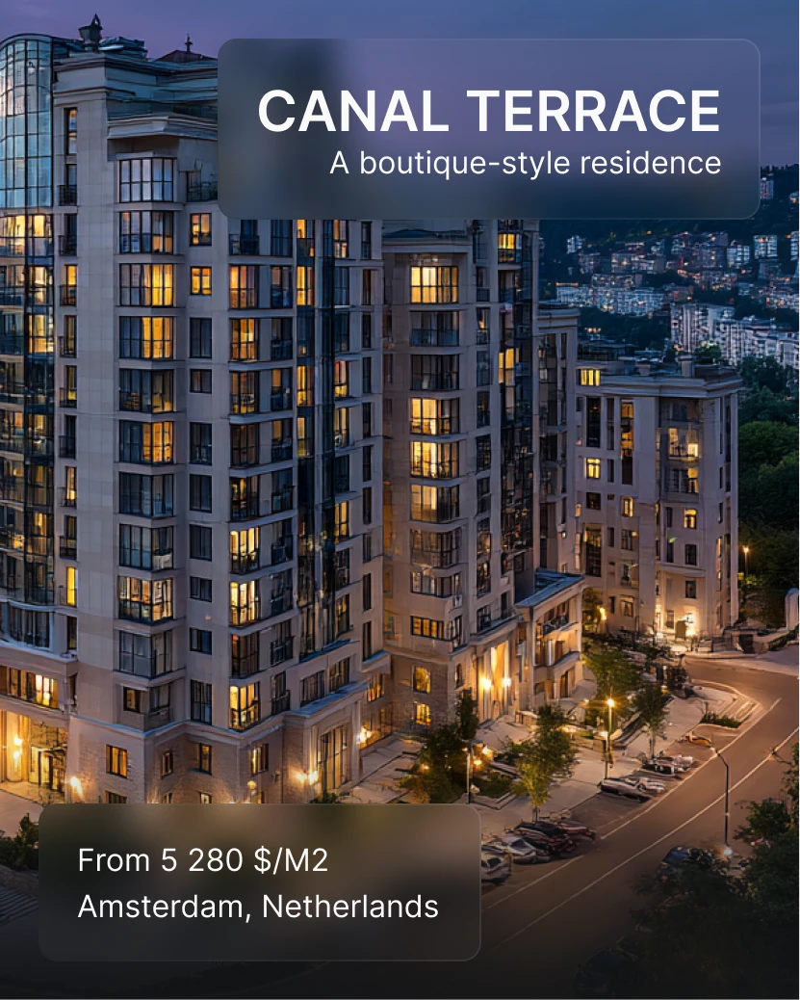

# Lit apartment complex at dusk with a top title panel and bottom price panel in frosted glass

**Discipline:** print-social · **Design type:** Social ad
**Tags:** real-estate, dusk, frosted-glass, white-caps, photo, portrait, price, luxury

## What it is
A portrait photo of a beige apartment complex with glowing windows over a hillside city at dusk, a frosted glass panel at the top with 'CANAL TERRACE' and 'A boutique-style residence', and a lower-left panel with price per square metre and city.

## What it means
Warm and aspirational; glass panels let the glowing windows lead.

## Techniques
- Place a frosted title panel at the top.
- Add a small price panel at the bottom.
- Shoot at blue hour.
- Keep type white and simple.

## Best for
- Property promotions
- Dusk photography ads
- Frosted-panel layouts

## Vocabulary
- **Blue hour** — The twilight period with deep blue light.
- **Frosted panel** — A blurred translucent box holding text.
- **Title/tagline pair** — A bold name and a light descriptor.
- **Price line** — A short line stating cost and place.
