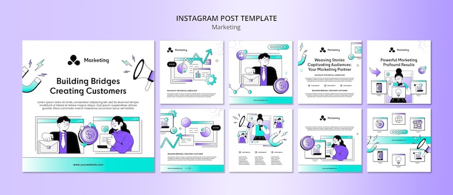

# 'Building Bridges, Creating Customers' marketing pack in white with teal-purple flat illustrations

**Discipline:** print-social · **Design type:** Social template pack · **Design style:** Playful & Illustrated
**Tags:** marketing, white, teal, purple, flat-illustration, instagram

## What it is
Nine white square posts with a small 'Marketing' magnet-icon logo, teal-to-purple gradient bars, flat illustrations of business people shaking hands, presenting charts and using phones, and headlines ('Building Bridges Creating Customers', 'Weaving Stories Captivating Audiences', 'Powerful Marketing Profound Results').

## What it means
Clean and professional; consistent gradient bars and figure illustrations make a marketing pitch feel approachable rather than corporate-stiff.

## Techniques
- Anchor every post with the same small icon logo.
- Use a gradient bar as a consistent footer or divider element.
- Illustrate business interactions (handshakes, presentations) literally.

## Best for
- Marketing agencies
- B2B service promotion
- Flat illustration branding

## Vocabulary
- **Gradient bar** — A strip filled with a colour fade, used as a structural element.
- **Figure illustration** — Flat-style drawings of people performing an action.
