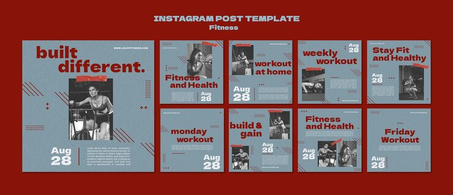

# 'Built different.' fitness pack in grey-blue with maroon type, tape strips and big dates

**Discipline:** print-social · **Design type:** Social template pack · **Design style:** Editorial
**Tags:** fitness, workout, maroon, grey-blue, tape, editorial

## What it is
Nine grey-blue square posts with heavy maroon lowercase headlines ('built different.', 'weekly workout', 'build & gain'), greyscale gym photos held by red tape strips, diagonal hatch marks, dot grids, plus signs and large white 'Aug 28' dates.

## What it means
Gritty and zine-like; tape and hatching feel handmade, motivating without gloss.

## Techniques
- Stick greyscale photos with coloured tape strips.
- Set lowercase heavy headlines for a casual voice.
- Add hatch marks and plus signs as texture.
- Anchor each post with a large date.

## Best for
- Gym schedules
- Workout challenges
- Gritty fitness brands

## Vocabulary
- **Tape strip** — A graphic of sticky tape holding an image.
- **Hatching** — Parallel diagonal lines used as texture.
