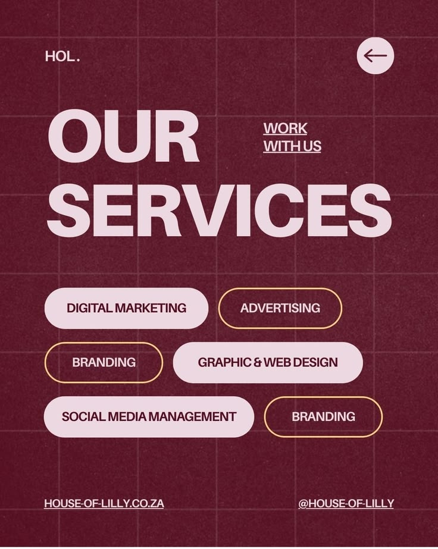

# Burgundy Services Pills Post

**Discipline:** print-social · **Design type:** Social promo post
**Tags:** services, burgundy, pink, pills, grid, grain, agency, condensed

## What it is
A burgundy portrait post with a faint pink grid and grain, a short logo, a circular back arrow, a huge pale pink 'OUR SERVICES' with a small underlined 'Work with us', six service pills alternating solid pink and gold outline, and a URL and handle at the base.

## What it means
Heavy pale type on deep burgundy is bold and elegant, and pills make a list into friendly tags.

## Techniques
- Huge heavy caps headline in pale pink
- Pills filled or outlined alternately
- Faint grid and grain over flat burgundy
- Small underlined call to action
- URL and handle at opposite base corners

## Best for
- Agency service overviews
- Two-colour social posts
- Pill-list layouts

## Vocabulary
- **Service pill** — A rounded label naming an offering.
- **Outline pill** — A pill drawn as an outline rather than filled.
- **Grain overlay** — Fine noise texture over a flat colour.
