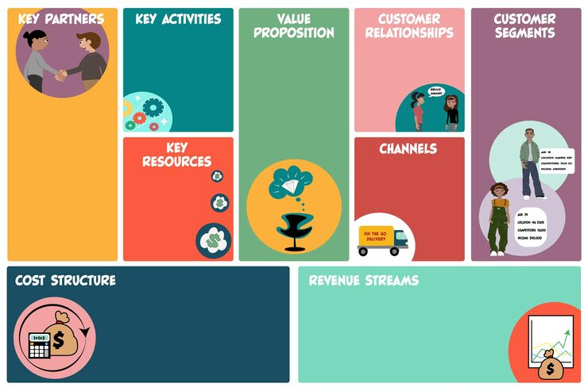

# Business Model Canvas diagram: nine colour-coded blocks with flat illustrated icons for each section

**Discipline:** print-social · **Design type:** Presentation slides · **Design style:** Corporate & Clean-Tech
**Tags:** business-model-canvas, framework, colour-blocks, flat-illustration, presentation

## What it is
The classic nine-block Business Model Canvas (Key Partners, Key Activities, Key Resources, Value Proposition, Customer Relationships, Channels, Customer Segments, Cost Structure, Revenue Streams) with each block in its own solid colour and a small flat illustration relevant to that section, like a handshake, gears or a delivery van.

## What it means
Instantly readable; giving every block both a colour and an illustration makes a dense strategy framework memorable at a glance.

## Techniques
- Assign one solid colour per section of a framework diagram.
- Pair every block with one small, literal illustration.
- Keep block proportions matched to the canvas's real relative importance.

## Best for
- Startup strategy presentations
- Business planning workshops
- Framework infographics

## Vocabulary
- **Business Model Canvas** — A strategic template for describing a business's value proposition and operations.
- **Colour-coded block** — A section distinguished by a unique fill colour.
