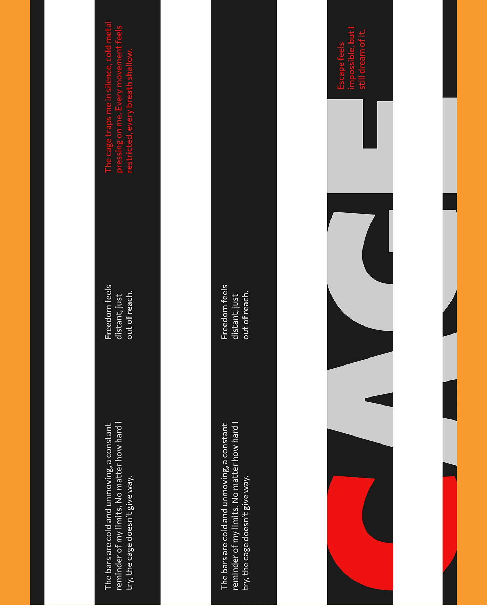

# Black-and-white barred poster with a giant rotated 'CAGE' and red rotated poem text

**Discipline:** print-social · **Design type:** Typographic posters
**Tags:** poster, bars, black, white, orange, red, rotated-type, concept

## What it is
A poster where vertical black and white bars sit between orange edges, a huge grey rotated 'CAGE' with a red C is sliced by the bars, and small rotated paragraphs in white and red sit in the black bars.

## What it means
Confining and tense; the bars literally cage the word.

## Techniques
- Slice giant type with bars to imply a cage.
- Rotate text 90 degrees inside the bars.
- Use one red for emphasis.
- Frame with orange side strips.

## Best for
- Concept typographic posters
- Series on themes
- Rotated-text layouts

## Vocabulary
- **Bar slicing** — Cutting text with stripes.
- **Rotated paragraph** — Body text turned 90 degrees.
- **Accent letter** — One letter in a contrasting colour.
- **Concept typography** — Type layouts that illustrate the meaning of the words.
