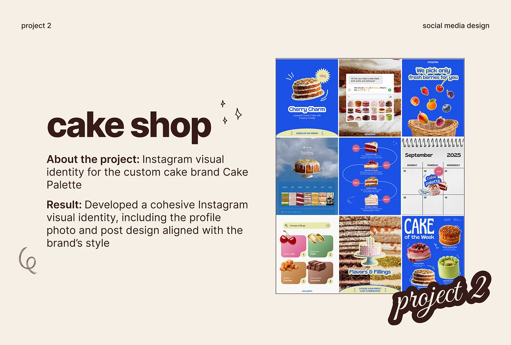

# Cream project slide for a cake-shop Instagram with a 3x3 feed grid and a 'project 2' script sticker

**Discipline:** print-social · **Design type:** Presentation slides
**Tags:** case-study, social-media, cream, brown, feed-grid, script-sticker, cobalt, bakery

## What it is
A cream slide with small header labels, a huge chocolate heavy 'cake shop', sparkle doodles, About and Result paragraphs with bold lead-ins and a boxed 3x3 grid of cobalt cake posts, with a big outlined script 'project 2' at the corner.

## What it means
Warm and organised; the cobalt feed pops against cream and brown.

## Techniques
- Use bold lead-ins.
- Show the whole feed grid as an image.
- Overlap a script sticker on its corner.
- Add small line doodles.

## Best for
- Social media project slides
- Food brand case studies
- Portfolio decks

## Vocabulary
- **Feed grid tile** — An image of a 3x3 profile grid.
- **Script sticker** — An outlined handwritten label.
- **Project counter** — A label numbering the project.
- **Line doodle** — A small hand-drawn mark.
