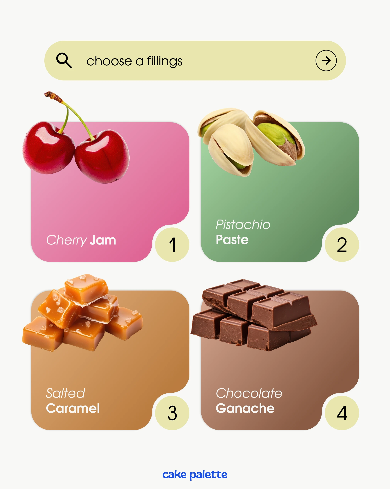

# Filling picker post with search bar and four gradient cards with corner number bubbles

**Discipline:** print-social · **Design type:** Social educational post
**Tags:** food, ui-parody, gradient-cards, cutout-food, numbers, search-bar, sage, cream

## What it is
A pale grey post with a lime search bar 'choose a fillings' at the top and four rounded gradient cards (pink, green, caramel, chocolate) each with a cut-out ingredient overlapping the top-left, an italic-and-bold label, and a cream circle number notched into the bottom-right corner. A small blue brand name sits at the bottom.

## What it means
Tasty and easy to scan; the interface look makes choosing feel like using an app.

## Techniques
- Colour each card to match its ingredient.
- Overlap the cutout product outside the card edge.
- Notch a number circle into the card corner.
- Mix light italic and bold in one label.

## Best for
- Menu and option-picking posts
- Food brands
- Posts imitating a UI

## Vocabulary
- **Notched corner** — A card corner cut away to hold a badge.
- **Ingredient cutout** — A food image without background.
- **Search-bar header** — A pill imitating a search field as a title.
- **Colour matching** — Card colour drawn from the product.
