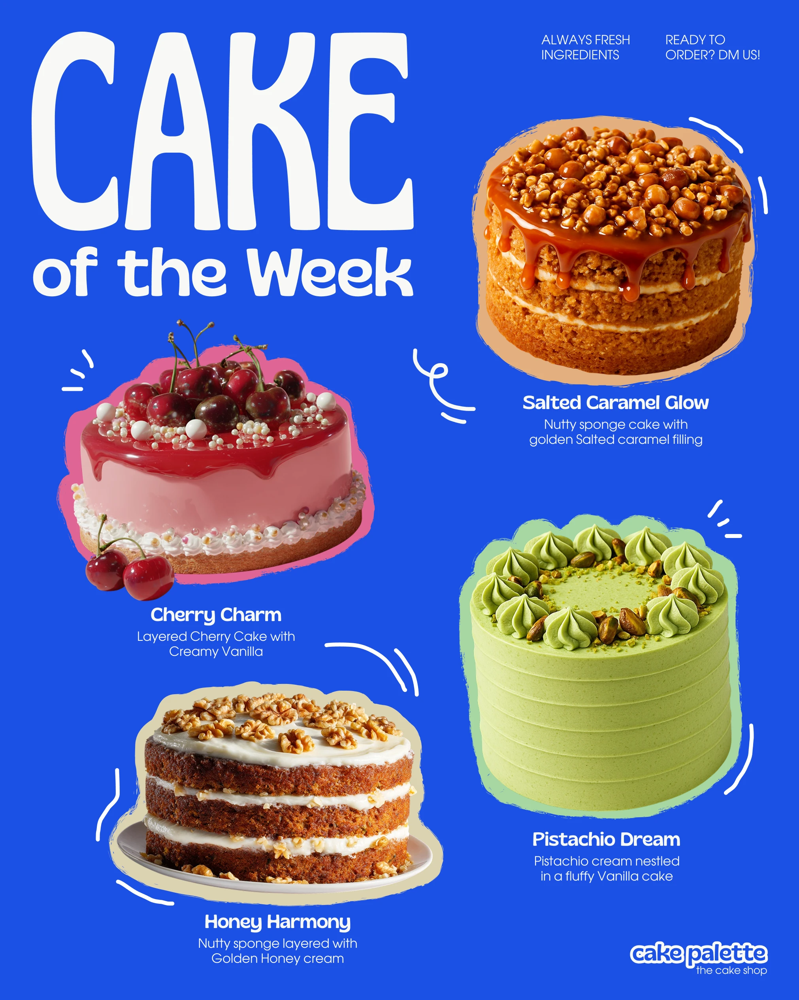

# Cobalt 'CAKE of the Week' menu with four cutout cakes on rough coloured halos

**Discipline:** print-social · **Design type:** Social promo post
**Tags:** menu, bakery, cobalt, condensed-type, cutouts, halos, squiggles, food

## What it is
A cobalt post with a huge white wavy 'CAKE' and 'of the Week', four cake photos each outlined by a rough halo in a matching colour (caramel, pink, green, cream), names in bold and short descriptions in light text, white doodle squiggles, and a small logo.

## What it means
Warm, appetising and playful; matching halos tie every cake to its flavour.

## Techniques
- Give each cutout a rough halo in a colour drawn from the food.
- Set an oversized title in a wavy display face.
- Scatter squiggle lines to suggest motion.
- Pair bold names with light descriptions.

## Best for
- Menu and product-of-the-week posts
- Bakeries and cafés
- Multi-item promos

## Vocabulary
- **Colour halo** — A rough shape behind a cutout in a matching hue.
- **Wavy display type** — Letters with slight distortion.
- **Squiggle accent** — A short doodle line suggesting motion.
- **Menu post** — A post listing items with names and descriptions.
