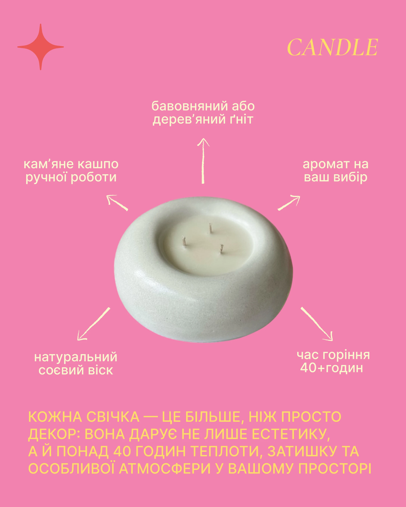

# Candle anatomy post with five hand-drawn arrows around a ceramic bowl on pink

**Discipline:** print-social · **Design type:** Social educational post
**Tags:** candle, diagram, pink, cream, yellow, arrows, product, cyrillic

## What it is
A bubblegum pink post with a red sparkle at the top left, a serif italic 'CANDLE' at the top right, a cutout white ceramic bowl candle with three wicks in the centre, five cream hand-drawn arrows pointing to labels (wick, scent, burn time, wax, handmade bowl) and a large yellow caps paragraph at the bottom.

## What it means
Clear and sweet; arrows turn product features into a readable diagram.

## Techniques
- Radiate hand-drawn arrows from the product.
- Use yellow and cream on pink.
- Add a small sparkle glyph.
- End with a big caps paragraph.

## Best for
- Product feature explainers
- Candle and craft posts
- Pink and yellow brands

## Vocabulary
- **Radial callouts** — Labels arranged around a product with arrows.
- **Hand-drawn arrow** — A sketchy arrow as annotation.
- **Sparkle glyph** — A four-point star accent.
- **Caps paragraph** — Body text set in uppercase.
